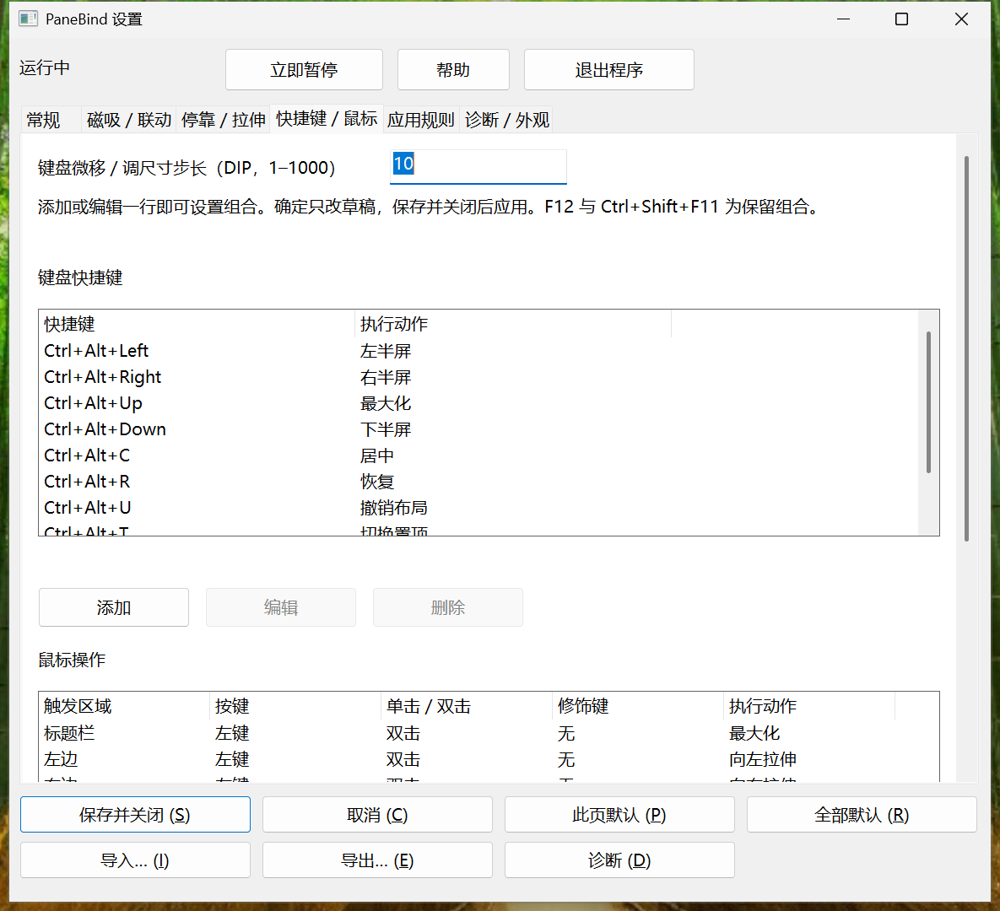
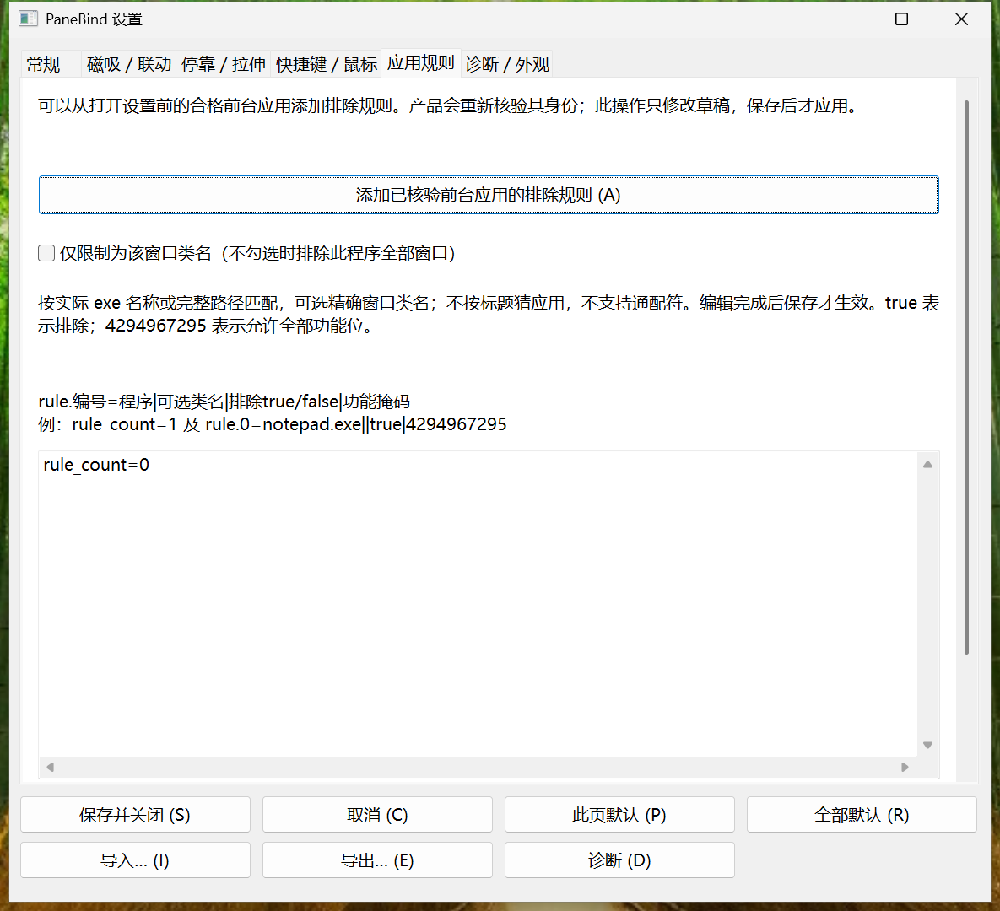

# PaneBind V1 设置界面与演示复核（2026-11-05）

当前待测为4d产品／2f2驱动／9498便携包，8643已部署，但象流占用和CIM FreeVirtualMemory门未放行，未启动；[新包及实际门](after/visible-delivery-package-8643.json)。下方c77/e60f是真实最近图，保其FAIL，不能改绑新候选。新候选六页0/6、演示0/16，T08/T09/T10/T07仍未完成。

当前实测为c77／e60f／144 DPI：六页、两张长页下半部、十二张窄图已取得。[六页原图](after/after-captures-e60f.json)、[实际范围](after/e60f-validation.json)、[窄说明视觉FAIL](after/e60f-visual-review.json)。T02限定通过，T08工具前置失败，T09/T10/T07未执行、0/16帧。原失败与DA7历史保留；正在范围内修复，不以阶段返回或CLI收尾授UI退出通过。以下e60f之前的0图/等待通知描述保留历史时点。

[e60f新guest包及部署核验](after/visible-delivery-package-e60f.json)已完成，产品c77／驱动352／打包6c0独立绑定，尚未启动。本轮没有资源或占用查询，等待当前通知后才单次核验。

本轮当前接续：冻结c77产品，352驱动已通过D/R构建、定向离线及宿主拒绝检查；现场顺序固定T01→T02→T08→T09→T10→T07。T03–T06未重跑，历史DA7结果不改绑。c77六页当前0/6，五段演示0/16，均NOT_RUN；停靠增加提交后/撤销前独立帧。当前资源尚未查，旧20:49只是历史。[当前准备证据](after/visible-delivery-preparation-3528059.json)、[集中报告最新段](../V1_DELIVERY_REPORT.md)。以下截图和原表为历史实测，继续保留其身份。

现在已有六页真实界面及DA7在150% guest的键鼠编辑/规则/配置操作实证。本轮仍未完成：窄窗说明裁切修复c77未现场，T07第二颜色未完成，T08–T10和五段15帧未执行。新c77构建通过不代表可试用；真人UAT PENDING，REA NOT_STARTED，V1 PARTIAL。

[六页真实PNG及两张长页下半部](after/README.md)来自DA7，不能改绑c77。[集中报告顶部](../V1_DELIVERY_REPORT.md)直接展示新界面，先看产品图而非分数。[源码/二进制/包/Run独立元数据](review.json)。

## 本轮真实界面

[常规](after/b453-page-0-top.png) · [磁吸／联动](after/b453-page-1-top.png) · [停靠／拉伸](after/b453-page-2-top.png) · [应用规则](after/b453-page-4-top.png) · [诊断／外观](after/b453-page-5-top.png)

所有原图保持原尺寸、未修绘。[b453逐图身份](after/after-captures-b453.json)、[窄窗真实文字缺陷](after/b453-visual-review.json)。窄列表的后列使用原生横向滚动，不由正常尺寸图片推断所有列已验收。

## 指定验证

| 项目 | 最近真实结果及身份 |
| --- | --- |
| T01 六页／窄窗／焦点 | DA7 自动可达与键盘导航通过；目视发现窄常规页三段长说明右裁，整体不授PASS。c77已修测量/绘制一致，现场NOT_RUN。 |
| T02 改键与取消 | DA7／f282限定PASS：取消后重开仍C；保存J后真实居中、旧C无新调用。 |
| T03 冲突保护 | DA7／f282限定PASS：重复/F12/保留键拒绝，真实F9占用、精确中文冲突、旧文件与J映射保留，自有注册已清理。 |
| T04 鼠标映射 | DA7／f282限定PASS：Ctrl+中键居中；UI删除后不再触发。 |
| T05 应用规则 | DA7／f282限定PASS：精确自有程序排除后原生START/END且零增强写入；UI删除后新手势恢复。 |
| T06 草稿／导入／重启 | DA7／f282限定PASS：页默认保其它草稿，中文/空格路径导入导出、高位保留，实际保存及同EXE正常重启读取。 |
| T07 颜色 | DA7／f282部分实测：取消、非法HEX、蓝色保存及真实不透明蓝预览通过；第二颜色的系统RGB定位工具失败，第二色与恢复未完成。d8后继工具修复尚未现场。 |
| T08 运行条／帮助 | NOT_RUN。已接真实按钮、外部热键和有效映射检查；构建不算行为通过。 |
| T09 普通新ZIP／退出 | NOT_RUN。中文空格目录无参、单实例、弃稿默认返回及运行条退出均未完成；已有CLI正常退出不能替代。 |
| T10 五段演示 | NOT_RUN，0/15帧。没有用历史几何链、退出码或绘制图片替代。 |

[f282独立核验与原件摘录](after/f282-validation.json)记录上述DA7限定结果；c77当前现场仍全部NOT_RUN。36f8、6b4、af10、b453、c156和f282的原FAIL均保留，工具修复不改写它们。当前资源阻断详见[a793两个真实时点](after/a793-resource-gate.json)；不轮询、不操作其它项目资源。

## 修改前／历史版本

[465基线六页及两张长页下半部](before/baseline465-captures.json)是本轮从冻结原EXE取得的真实150%图；不是当前新界面。[此前三张历史图](before/historical-captures.json)继续保留原4f7/11ae身份及原HC恢复FAIL。

## 五段动作帧与候选

[演示清单](demo/README.md)为0/15，不使用旧链或效果图替代。最新Release候选取得方式、包哈希与准确来源以[集中报告封包绑定](../V1_DELIVERY_REPORT.md)及review.json为准；原包和原回执不改。仅授权guest，未批准公开发布或普通宿主试用。[图形使用说明](../../V1_QUICK_START.md)不要求用户计算键码、序号或掩码。
