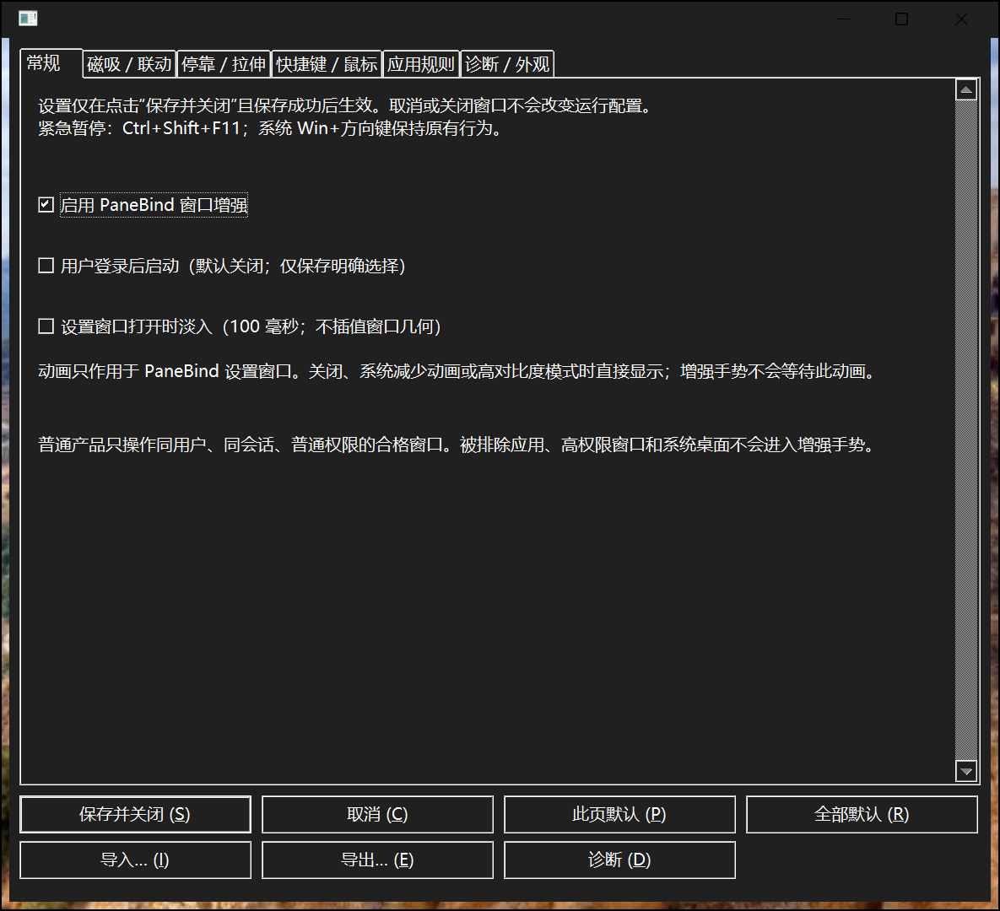
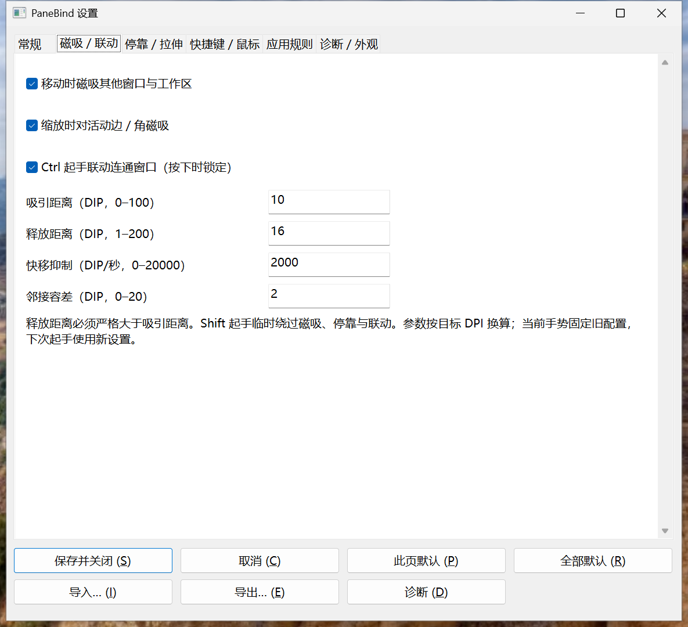
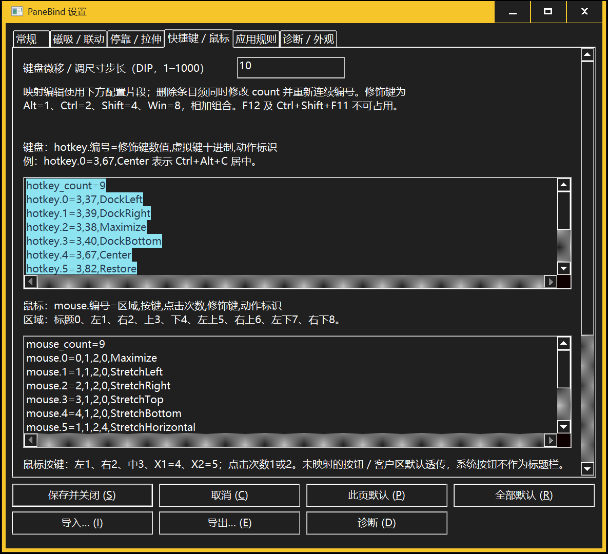

# PaneBind V1 设置界面与演示复核（2026-11-05）

**新候选已实现并构建；新界面截图、动作帧和T01–T10现场验证尚未取得。** 不把旧图片当成新界面，也不提供效果图替代。当前Sandbox属于象流，不能接管、抢占或启动第二实例；已发出释放时段询问，期间不轮询。

产品源码 `1aabd344ad88bfcf36d7d611ee809a6da1e10ea1`，Release EXE SHA-256 `11F5C3C7DA297AED7D9DDEB7215371F5C96F852ACC376B844C453BFD547D9A82`。产品、驱动、包和运行各自绑定，详见[复核元数据](review.json)及[集中报告](../V1_DELIVERY_REPORT.md)。普通宿主试用未开放，真人UAT PENDING、REA NOT_STARTED。

## 新界面（after）

[尚缺的六页实际图片](after/README.md)明确为0/6；不能据源码或构建推断文字、裁切、焦点、点击和颜色预览通过。

## 修改前／历史版本（before）

下面是实际历史产品窗口，均144 DPI（150%），不是465或新候选；8d8a两图在高对比度ON时拍摄，其原恢复FAIL保留。[完整原件、像素等价、源码、EXE、Run及哈希](before/historical-captures.json)。尚缺“停靠／拉伸、应用规则、诊断／外观”三页；冻结465的独立历史UI0包已部署但未启动。

## 指定验证

| 编号 | 目标 | 实际状态 |
| --- | --- | --- |
| T01 | 六页、窄窗、滚动与键盘焦点 | NOT_RUN：等待合法Sandbox时段 |
| T02 | C→J映射、取消草稿与真实居中 | NOT_RUN：等待合法Sandbox时段 |
| T03 | 重复/保留键及实际注册占用 | NOT_RUN：等待合法Sandbox时段 |
| T04 | Ctrl+中键映射的添加/生效/删除 | NOT_RUN：等待合法Sandbox时段 |
| T05 | 排除规则、恢复及中文路径/高位 | NOT_RUN：等待合法Sandbox时段 |
| T06 | 页默认、导入/导出、取消及重启 | NOT_RUN：等待合法Sandbox时段 |
| T07 | 系统选色/HEX与真实预览像素 | NOT_RUN：等待合法Sandbox时段 |
| T08 | 即时暂停/恢复、草稿及外部状态 | NOT_RUN：等待合法Sandbox时段 |
| T09 | 新ZIP普通入口/单实例/正常退出 | NOT_RUN：等待合法Sandbox时段 |
| T10 | 五段真实动作及原尺寸帧 | NOT_RUN：等待合法Sandbox时段 |

两个窄suite均保留exact guest、只读输入、独立输出、身份及前台守卫。`SettingsUiReviewOnly`用于实际页面捕获；`SettingsEditorsOnly`为Release专用，T09普通ZIP检查后再起同一二进制做T10。返回/退出码不替代每项断言与人工图片复核；出现产品/驱动缺陷仍按影响修复，不增无关Full或900秒。

## 五段动作帧

[演示次序与未运行状态](demo/README.md)。当前0/15张，不以历史几何链补写，也不外推完整I02/I03或五应用兼容。
