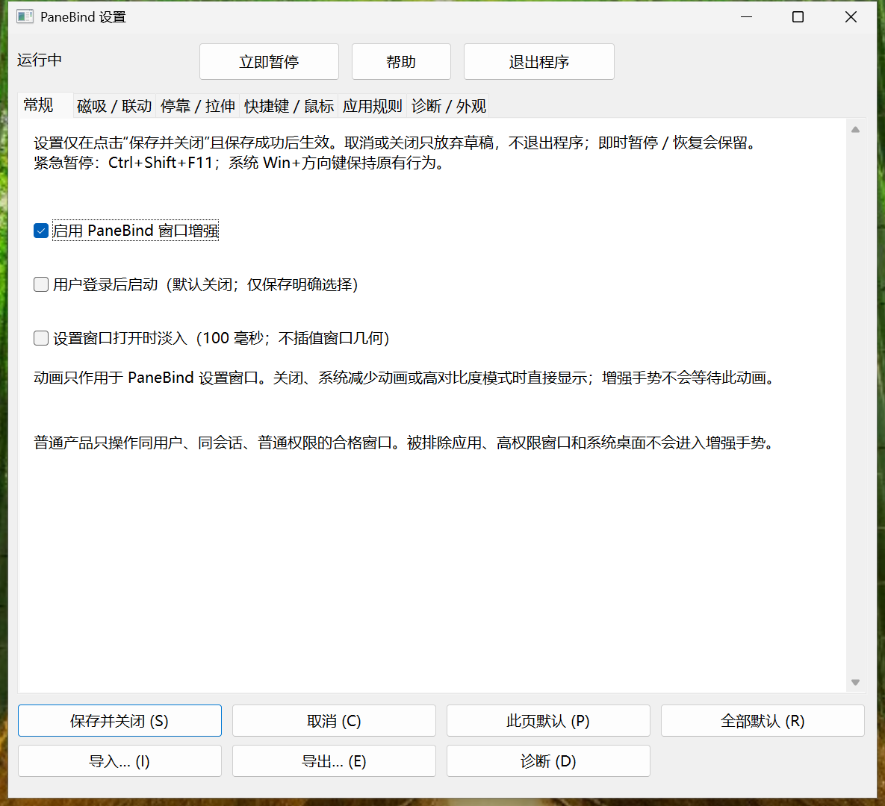
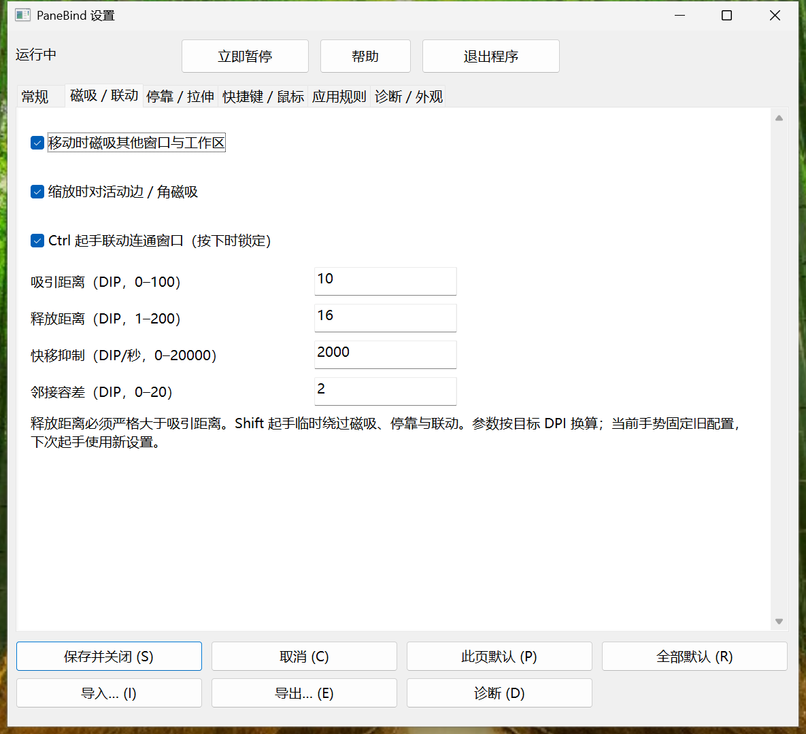
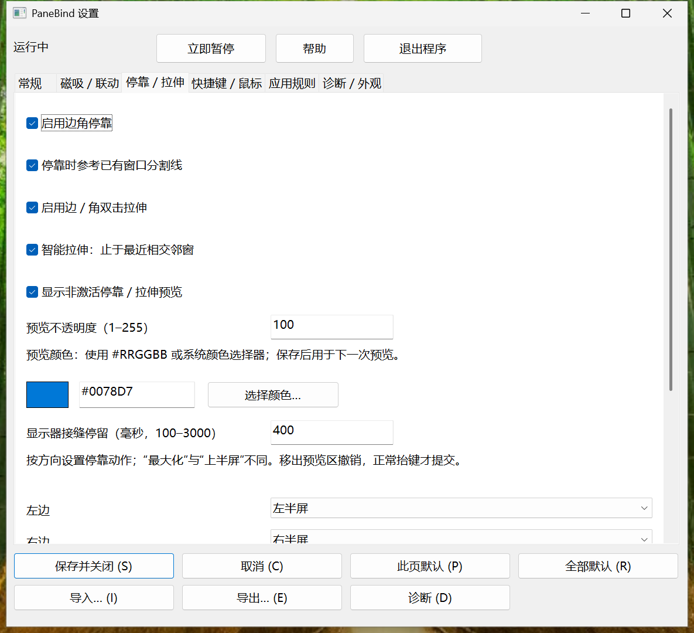
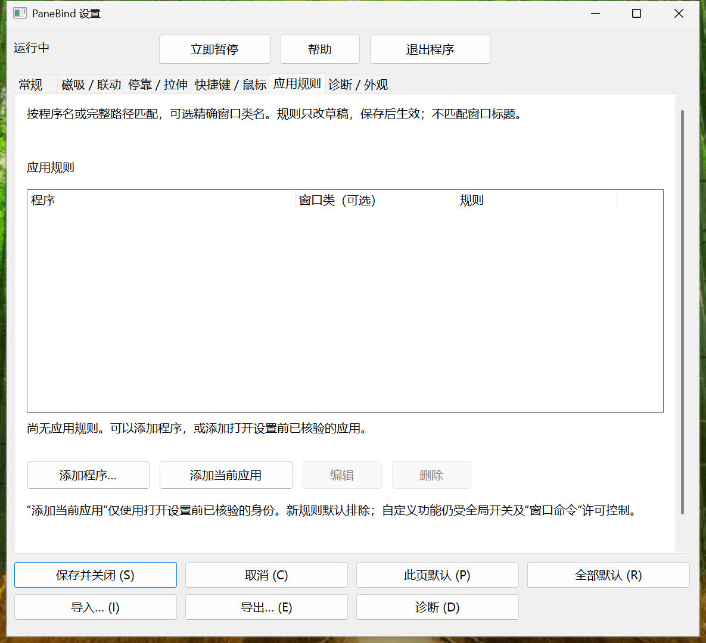
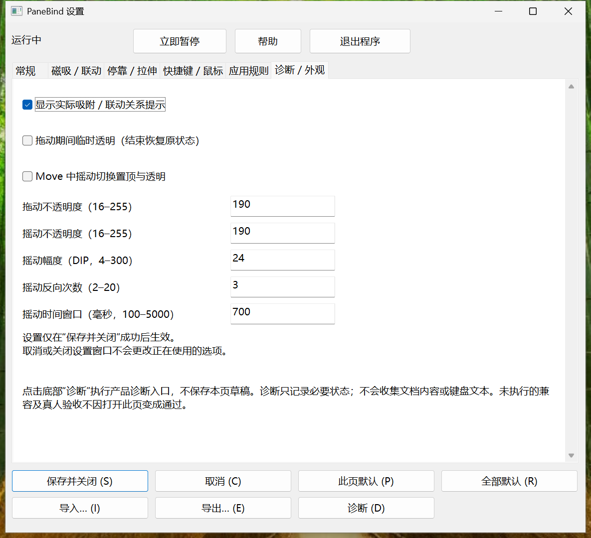
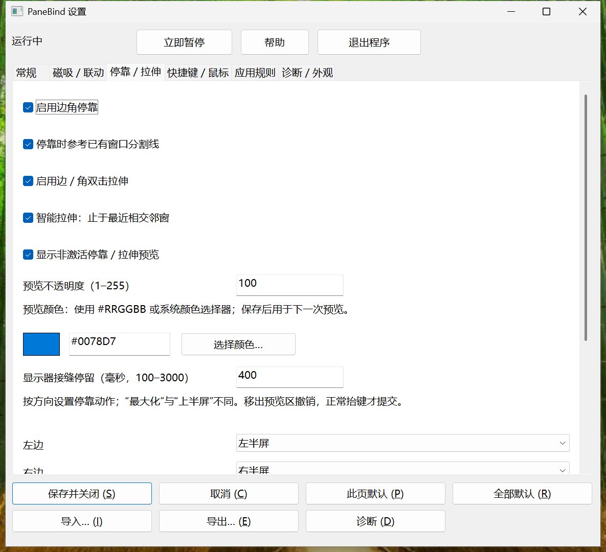
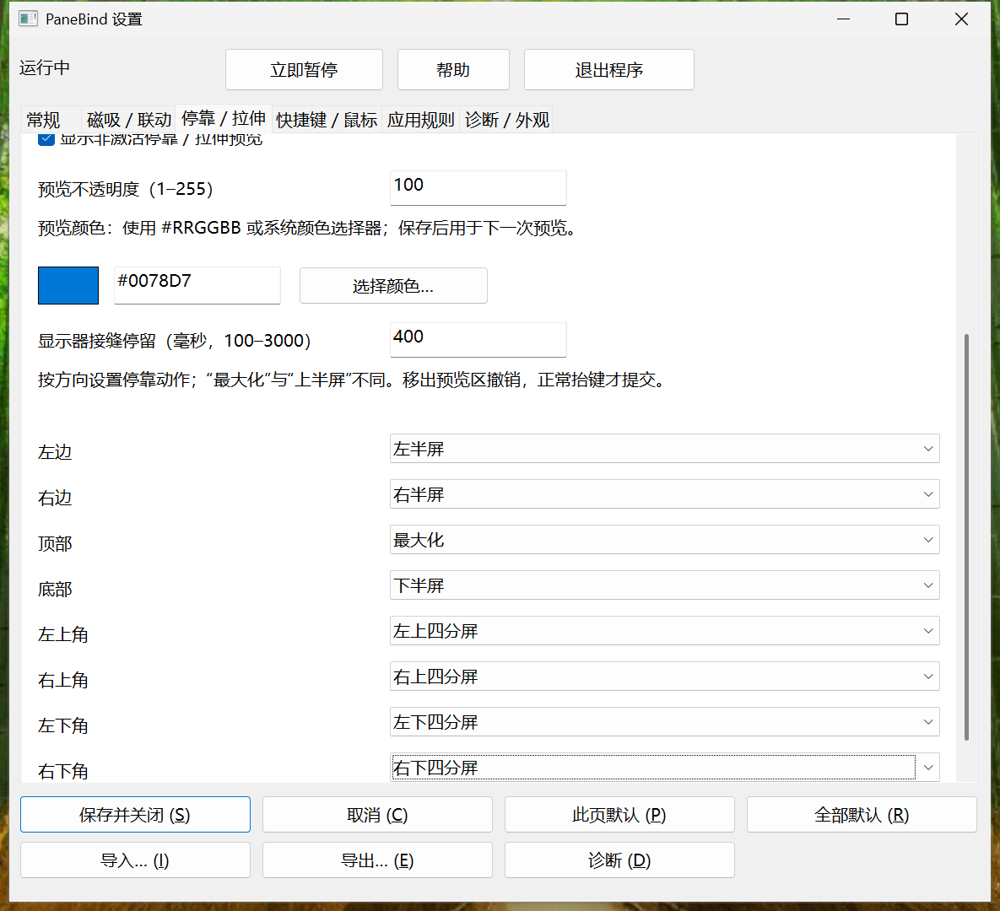
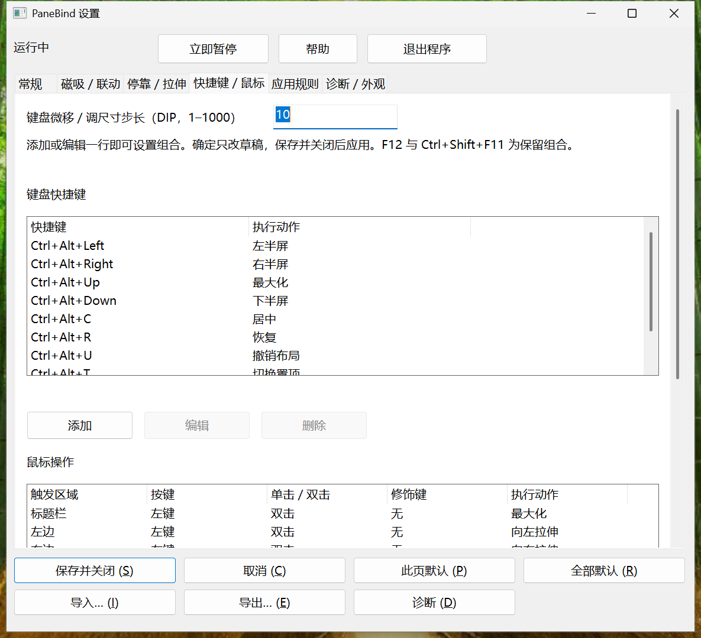
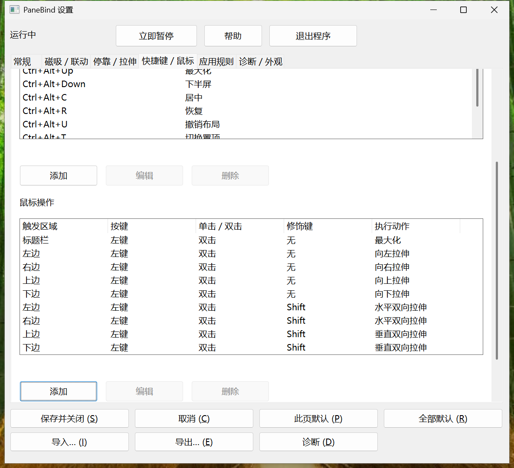

# 最近实测候选六页原尺寸截图

## 当前实测：c77／e60f／144 DPI

[逐图身份](after-captures-e60f.json) · [目视FAIL与范围](e60f-visual-review.json) · [实际输入和收尾](e60f-validation.json)。正常六页已取得，窄常规说明仍FAIL，原图不修绘。

[停靠下半页](e60f-page-2-bottom.png) · [快捷键下半页](e60f-page-3-bottom.png) · [窄常规缺陷](e60f-page-0-narrow-bottom.png)

## 历史DA7（原身份保留）

以下为真实产品 `da7a858f24e1baba6c06aac3dd317db5043ca871`，Release EXE SHA-256 `EB76FE74E9A96D891972928B1399E5247AD1F5779A598A99003D8BACBA2726B9`。Run `b4538983dc6a4b26a071a90e630274a6`，实际 **144 DPI／150%**，原尺寸 PNG 未修绘。图片不代表整个运行通过；该 Run 的 T03 工具文案预期失败保留。后继 c77 已修窄窗说明绘制，但尚未现场；这些图不能作为 c77 的六页截图。

[逐图源码、产品／驱动哈希、窗口身份、DPI、原始位置与校验](after-captures-b453.json)。原始六页、两张长页下半部及十二张窄窗图全部保留；更新驱动不会把这些图片改绑新 Run。

## 常规

## 磁吸／联动

## 停靠／拉伸

## 快捷键／鼠标

## 应用规则

## 诊断／外观

正常尺寸目视复核：主要中文与按钮可读；长页通过真实滚动到达，列表保留原生内部滚动。T01 的窄窗实际键盘焦点、正反 Tab、Ctrl+Tab、可达控件与原生控件 ID 另有运行断言，**窄常规页三条长说明仍有右侧裁切**，见[原图与独立缺陷摘录](b453-visual-review.json)。自动可达通过不等于完整 T01 通过。100%／200%、完整桌面、托盘和多屏仍保留原暂缓状态；真人 UAT 未执行。
